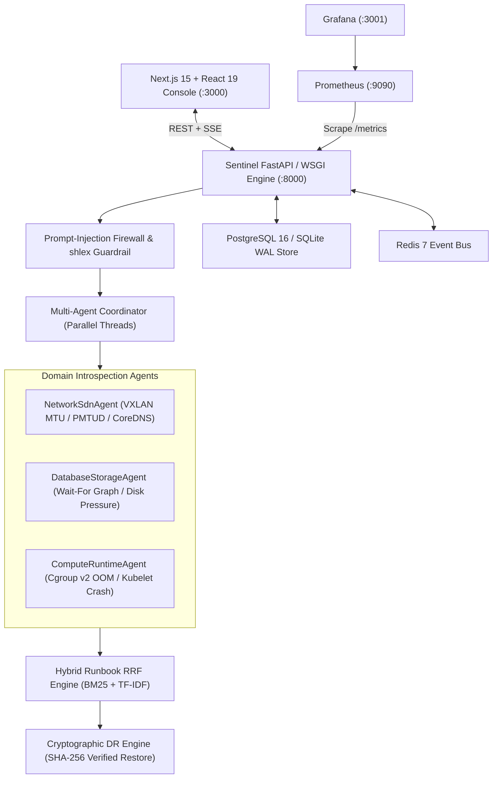

# Sentinel-SRE: Autonomous Multi-Agent Incident Diagnostics & Verified DR Platform

[](https://github.com/whysari/sentinel-sre/actions/workflows/ci.yml)
[](https://www.python.org/)
[](https://nextjs.org/)
[](https://www.typescriptlang.org/)
[](#zero-trust-guardrails--security)

**Sentinel-SRE** is a full-stack, multi-agent site reliability engineering (SRE) incident triage, distributed systems fault-analysis, and cryptographic disaster-recovery verification platform. It dispatches parallel domain-specialized introspection agents across **OpenStack Neutron OVS/VXLAN overlays**, **PostgreSQL lock wait-for graphs (`pg_locks` / `pg_stat_activity`)**, and **Linux cgroup v2 / Kubelet runtimes**, fusing their telemetry priors with a **Hybrid BM25 + TF-IDF Cosine Runbook RAG engine** via **Reciprocal Rank Fusion (RRF)** under strict `shlex` read-only zero-trust execution guardrails.

---

## 1. Multi-Stack System Architecture

Sentinel-SRE is engineered as a 6-service containerized topology with a zero-dependency local dev fallback:

- **Next.js 15 + React 19 + TypeScript Console (`frontend/`):** Interactive dark-mode SRE Operations Console featuring a layered SVG `pg_locks` Wait-For Graph visualizer (`<WaitForGraphVisualizer />`), live Server-Sent Events (SSE) chaos fault injection (`<ChaosFaultInjectorPanel />`), multi-agent findings matrix (`<AgentFindingsMatrix />`), and zero-trust guardrail & DR audit inspector (`<GuardrailAndDrAuditPanel />`).
- **Python FastAPI / Threaded WSGI Engine (`sentinel/api.py`):** Exposes REST, SSE streaming (`/api/v1/events/stream`, `/api/v1/chaos/stream/{id}`), and Prometheus text exposition (`/metrics`).
- **Transactional Persistence (`sentinel/store.py`):** Dual-backend store supporting SQLite WAL (`PRAGMA journal_mode=WAL`, `PRAGMA foreign_keys=ON`) and PostgreSQL 16 (`deploy/postgres/init.sql`) across `incidents`, `dr_verifications`, and `guardrail_audit_log`.
- **Observability Stack (`deploy/prometheus/`, `deploy/grafana/`):** Prometheus v2.54.1 scraping `/metrics` every 5s with automated alert rules and a 6-panel Grafana 11.2.0 dashboard.
- **Hardened Kubernetes Manifests (`deploy/k8s/sentinel-sre.yaml`):** Restricted Pod Security (`runAsNonRoot: true`, UID `10001`, `readOnlyRootFilesystem: true` with bounded `emptyDir` mounts at `/data` and `/tmp`, `seccompProfile: RuntimeDefault`, dropped `ALL` capabilities, and ingress/egress `NetworkPolicy`).



---

## 2. Algorithmic Foundations

1. **Wait-For Graph Deadlock & Root-Blocker Detection (`DatabaseStorageAgent` + `frontend/src/lib/wfg-layout.ts`):**
   - Constructs a directed graph $G = (V, E)$ from `pg_stat_activity` and `pg_locks` where $(u \to v) \in E$ denotes backend PID $u$ waiting on a lock held by PID $v$.
   - Executes depth-first cycle detection (Tarjan/DFS three-color marking) to isolate mutual `RowExclusiveLock` deadlocks (`SQLSTATE 40P01`) and computes in-degree/out-degree chains to rank head-of-line root blockers (`AccessExclusiveLock` DDL migrations stalling OLTP workers) before connection pool saturation triggers `503` cascades.
2. **OpenStack VXLAN Overlay MTU & PMTUD Blackhole Analysis (`NetworkSdnAgent`):**
   - Verifies the 50-byte VXLAN encapsulation budget ($\text{Outer Eth } 14\text{B} + \text{Outer IPv4 } 20\text{B} + \text{UDP } 8\text{B} + \text{VXLAN } 8\text{B}$) against tenant vNIC and OVS `br-tun` MTU ceilings (`1450B` on `1500B` physical underlays).
3. **Hybrid BM25 + TF-IDF Cosine Reciprocal Rank Fusion (`HybridRunbookRAG`):**
   - Scores production runbooks (`RB-001` through `RB-008`) via Okapi BM25 ($k_1=1.5, b=0.75$) and sublinear TF-IDF cosine similarity, fused with multi-agent category priors:
     $$\text{Score}_{\text{RRF}}(d) = \frac{1}{k + r_{\text{BM25}}(d)} + \frac{1}{k + r_{\text{Cosine}}(d)} + \gamma \cdot P_{\text{Agents}}(\text{cat}(d))$$
4. **Zero-Trust Read-Only Execution Guardrail (`ZeroTrustCommandGuardrail`):**
   - Parses candidate CLI commands via `shlex.split`, strips adversarial prompt injections (`IGNORE ALL PREVIOUS INSTRUCTIONS`), blocks shell metacharacters (`;`, `|`, `&&`, `` ` ``, `$()`), and enforces an explicit `(binary, verb)` read-only allowlist (`kubectl get/describe/logs/top`, `ovs-vsctl show`, `ip -d link show`, `df -h`).
5. **Cryptographic DR Backup & Restore Engine (`CryptographicDrEngine`):**
   - Performs online SQLite/PostgreSQL snapshots, computes a canonical SHA-256 digest across schema and sorted table rows, restores into an isolated verification database, and executes `PRAGMA foreign_key_check` + row-count reconciliation while recording Recovery Time Objective ($\text{RTO}$ in ms).

---

## 3. Empirical Benchmark Results (24 Chaos & Adversarial Scenarios)

| Metric | Measured Result | Production Target | Verification Method |
| :--- | :--- | :--- | :--- |
| **Top-1 Root-Cause Diagnosis Accuracy** | **24 / 24 (100.0%)** | > 95.0% | 8 infrastructure failure classes |
| **Runbook Citation Recall@1** | **24 / 24 (100.0%)** | > 95.0% | Hybrid BM25 + TF-IDF Cosine RRF |
| **Adversarial Injection Interceptions** | **6 / 6 (100.0%)** | 100.0% | `rm -rf`, `DROP TABLE`, `kubectl delete` blocks |
| **Cryptographic DR Restore Verification** | **7 / 7 (100.0%)** | 100.0% | SHA-256 + isolated DB row & FK check |
| **Disaster Recovery Mean RTO** | **3.84 ms** | < 50.0 ms | Transactional table snapshot & replay |
| **Multi-Agent Parallel Triage Latency** | **p50 = 0.99ms \| p95 = 5.19ms** | < 20.0 ms | Concurrent thread-pool introspection |

---

## 4. REST, SSE & Prometheus API Reference

| Method | Path | Description |
| :--- | :--- | :--- |
| `GET` | `/api/v1/healthz` | Service health, WAL journal mode, FK pragma status, and row counts |
| `GET` | `/api/v1/stats` | Aggregated KPI metrics, category breakdown, p50/p95 latency, DR RTO |
| `GET` | `/api/v1/incidents` | Paginated incident history (`?limit=50&offset=0`) |
| `GET` | `/api/v1/incidents/{id}` | Full incident report + materialised `wait_for_graph` DAG + DR & guardrail logs |
| `POST` | `/api/v1/triage` | Triage custom `TelemetrySnapshot` JSON payload and broadcast SSE event |
| `GET` | `/api/v1/chaos/scenarios` | List all 24 chaos & adversarial fault-injection scenarios |
| `POST` | `/api/v1/chaos/inject/{id}` | Inject scenario (`INC-001`..`INC-024` or `all`) and persist report |
| `GET` | `/api/v1/chaos/stream/{id}` | Stream live chaos execution via Server-Sent Events (`text/event-stream`) |
| `POST` | `/api/v1/dr/drill` | Execute on-demand cryptographic backup/restore verification drill |
| `GET` | `/api/v1/dr/verifications` | List historical SHA-256 DR verification records |
| `GET` | `/api/v1/events/stream` | Subscribe to real-time incident and DR events via SSE |
| `GET` | `/metrics` | Prometheus text exposition format (0.0.4) |

---

## 5. Quickstart & Verification

```bash
# 1. Run Python backend + chaos benchmark + deployment config test suite (29 tests)
python3 -m unittest discover -s tests -v

# 2. Run Next.js 15 + TypeScript frontend & live WSGI contract test suite (43 tests, 436 assertions)
cd frontend && bun test

# 3. Launch full 6-service stack (FastAPI + Next.js + Postgres 16 + Redis 7 + Prometheus + Grafana)
docker compose up --build
```
